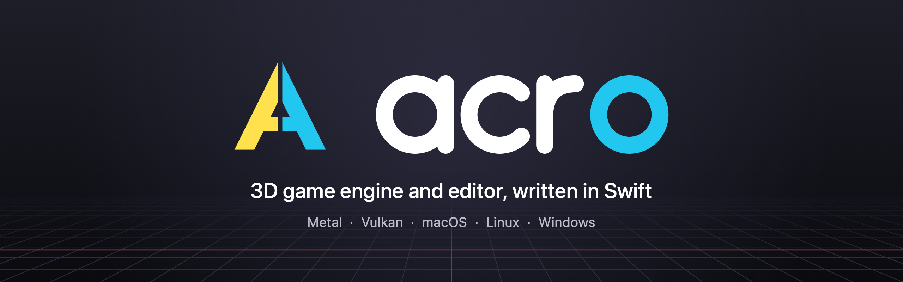
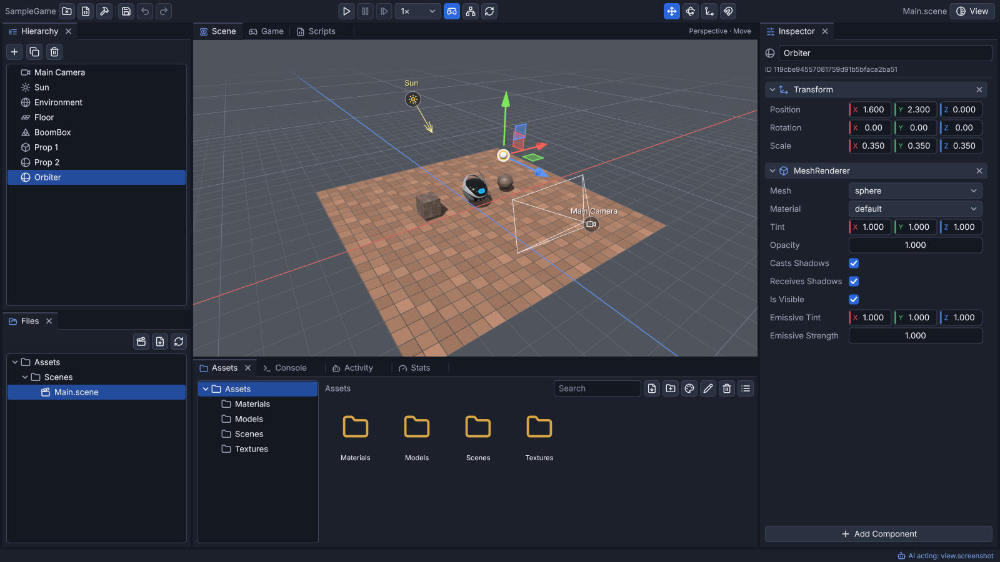

<p align="center"></p>

<p align="center">
  <a href="LICENSE"></a>
  
  
</p>

Acro is a cross-platform 3D game engine and editor written in Swift. It renders with Metal on macOS and Vulkan on Linux and Windows. You write games in plain Swift, edit scenes in the editor, and reload game code while the editor is running. An AI agent can drive the editor too, through its built-in MCP server.



## Contents

- [Features](#features)
- [Quick start](#quick-start)
- [Run the demo](#run-the-demo)
- [Use the editor](#use-the-editor)
- [Make a game](#make-a-game)
- [Builder tools](#builder-tools)
- [Building](#building)
- [Project layout](#project-layout)
- [Documentation](#documentation)
- [License](#license)

## Features

- **Rendering:** a backend-neutral graphics API with Metal and Vulkan backends, physically based materials, directional and local lights, shadows, environment lighting, decals, reflections, HDR post-processing, and spatial and temporal upscaling.
- **Scene and gameplay:** an entity-component system, transform hierarchies, staged systems, undoable scene changes, animation, GPU particles, 3D and 2D physics, input actions, gamepads, and audio.
- **Assets:** glTF 2.0 / GLB and OBJ import, textures, materials, procedural textures, mesh arrays, prefabs and variants, asset tracking, file watching, and a Library cache.
- **Editor:** scene hierarchy and inspector, asset browser, viewport picking and transform gizmos, docking, game-module hot reload, and project workflows.
- **Builder tools:** in-editor authoring for models, visual effects, camera looks, terrain, sound effects, and data tables, with no outside programs needed.
- **AI control:** the editor's commands are available as MCP tools, so an agent can build scenes and assets the same way a person does.
- **Runtime and tools:** dynamically loaded Swift game modules, a standalone game runner, settings and save games, networking, CPU profiling, debug overlays, and project cooking and export.

## Quick start

Clone the repository, then run the demo and the editor with Swift Package Manager. Use release builds (`-c release`) unless you are debugging; debug builds are much slower per frame.

**macOS** (Metal):

```sh
swift run -c release Demo
swift run -c release Editor
```

**Linux** (Vulkan), on Debian or Ubuntu:

```sh
sudo apt install libvulkan-dev libglfw3-dev zlib1g-dev pkg-config glslc
swift run -c release Demo
swift run -c release Editor
```

**Windows** (Vulkan): see [Building on Windows](#windows). Windows support is configured but has not yet been tested on a Windows machine.

## Run the demo

The demo is a collection of scenes for exploring engine features and checking rendering. List the scenes or start one by name:

```sh
swift run -c release Demo --list
swift run -c release Demo --scene shadows --quality ultra
```

Options cover the graphics backend, render quality, resolution, and upscaler settings; run `swift run -c release Demo --help` to see them all.

## Use the editor

Open the editor with an optional scene file or project folder:

```sh
swift run -c release Editor [scene.json]
swift run -c release Editor --project path/to/project
```

To build the example game module and reload it whenever its source changes:

```sh
swift run Editor --game SampleGame --game-watch
```

### AI control (MCP)

The editor can serve its command registry as an MCP server, so AI clients can open projects, edit scenes, and create assets:

```sh
swift run -c release Editor --mcp
```

For example, to add it to Claude Code:

```sh
claude mcp add acro -- swift run -c release Editor --mcp
```

The [MCP tool reference](docs/MCPTools.md) lists every tool with its parameters.

## Make a game

A game is a type that conforms to `Game`. The engine calls `setup` once, `update` every frame, and `render` to record the screen pass. Use `renderOffscreen` for work such as shadow maps.

```swift
import Engine

@MainActor
final class MyGame: Game {
    func setup(engine: Engine) throws {
        // Create game resources.
    }

    func update(engine: Engine, dt: Float) {
        // Advance the game by dt seconds.
    }

    func render(engine: Engine, pass: RenderPass) {
        // Record rendering for this frame.
    }
}

@main
enum Main {
    static func main() {
        Engine(config: EngineConfig(title: "My Game")).run(MyGame())
    }
}
```

For a larger example with custom components and systems, see [Sources/SampleGame](Sources/SampleGame). Run it in the editor or on its own:

```sh
swift run Editor --game SampleGame
swift run GameRunner SampleGame
```

The editor and `GameRunner` build and load game modules dynamically. While you edit, the editor can watch the source and reload game code without closing the open scene. To cook and export a project for distribution, see the packaging options in `swift run Editor --help`.

## Builder tools

Builders let you make game content inside the editor. Each one stores its asset as a JSON file under `Assets/`, has its own editor tab with a live preview, and has matching MCP tools so an agent can make the same assets. Placed copies update when the file changes.

| Builder | File | Makes |
|---|---|---|
| [Mesh Builder](docs/Builders.md#mesh-builder) | `.meshbuild` | Models from primitive shapes, with materials and animation |
| [VFX Builder](docs/Builders.md#vfx-builder) | `.vfx` | Effects made of stacked GPU particle emitters |
| [Post-FX Builder](docs/Builders.md#post-fx-builder) | `.postfx` | Camera looks: tonemapping, bloom, grading, vignette, grain |
| [Terrain Builder](docs/Builders.md#terrain-builder) | `.terrain` | Sculpted, painted heightmap terrain with scattered props |
| [Sound Builder](docs/Builders.md#sound-builder) | `.sfx` | Synthesized sound effects |
| [Data Table Builder](docs/Builders.md#data-table-builder) | `.table` | Typed spreadsheets for game data |

See [docs/Builders.md](docs/Builders.md) for how to use each one.

## Building

Build every product with:

```sh
swift build -c release
```

### macOS

Metal works out of the box. The Vulkan backend is also built when the Vulkan headers are installed:

```sh
brew install vulkan-loader vulkan-headers molten-vk glfw shaderc pkgconf
swift run -c release Demo --backend vulkan
```

Set `ENGINE_DISABLE_VULKAN=1` to build without Vulkan.

### Linux

Install the Vulkan, GLFW, zlib, and pkg-config development packages. On Debian or Ubuntu:

```sh
sudo apt install libvulkan-dev libglfw3-dev zlib1g-dev pkg-config glslc
```

### Windows

Windows builds need Swift for Windows, the LunarG Vulkan SDK, GLFW, and zlib. Set `VULKAN_SDK`, `GLFW_DIR`, and `ZLIB_DIR` to their install locations before building; the package uses the headers and libraries under those folders. This setup is configured but has not yet been tested on a Windows machine.

```bat
set GLFW_DIR=C:\glfw-3.4.bin.WIN64
set ZLIB_DIR=C:\vcpkg\installed\x64-windows
swift build -c release
swift run -c release Demo
```

The engine links `zlib.lib`. vcpkg's zlib 1.3.2 and later installs it as `z.lib`, so copy `%ZLIB_DIR%\lib\z.lib` to `zlib.lib` if it's missing.

### Using Acro as a package dependency

The package exports the `Engine` and `EngineMCP` libraries. Add Acro with SwiftPM, then `import Engine` in a target that depends on the `Engine` product. On Windows the package currently needs unsafe compiler and linker flags, which limits its use as a dependency there.

### Graphics backends and shaders

Game rendering goes through the `RenderDevice`, `RenderPass`, and `ComputePass` APIs, so the same game code runs on Metal and Vulkan without calling either native API. Choose a backend with `EngineConfig.backend`, the `--backend` flag, or the `ENGINE_BACKEND` environment variable. The default is Metal on macOS and Vulkan elsewhere.

Engine shaders are written in GLSL. The generated SPIR-V and Metal files are committed, so normal builds don't need shader tools. After editing GLSL, run `Scripts/compile-shaders.sh` to regenerate them; it needs `glslc` and SPIRV-Cross.

### Continuous integration

GitHub Actions runs on every push and pull request:

| Workflow | What it does |
|---|---|
| macOS | Builds and runs `swift test` on Xcode 27 |
| Linux | Builds and runs `swift test` in the `swift:6.4-noble` container, with GPU tests on lavapipe (software Vulkan) |
| Windows | Build only; the hosted runner has no GPU |
| Docs | Builds the Engine API reference, and publishes it to GitHub Pages from `main` |

CI doesn't render the demo scenes. Check rendering changes locally with `Scripts/render-scenes.sh`, which renders every scene on each available backend and checks that they match. To reproduce the Linux job locally, run `Scripts/linux-docker-ci.sh`.

## Project layout

| Path | Contents |
|---|---|
| `Sources/Engine/` | Engine runtime: core, graphics, rendering, scene/ECS, assets, physics, audio, UI, text, animation, networking, and persistence |
| `Sources/Engine/Backends/` | Metal and Vulkan graphics backends |
| `Sources/EditorCore/`, `Sources/Editor/` | Editor implementation and executable |
| `Sources/Demo/` | Feature and rendering demo |
| `Sources/SampleGame/`, `Sources/GameRunner/` | Example game module and standalone runner |
| `Sources/EngineMCP/` | MCP protocol implementation |
| `Sources/C*`, `Windows/` | Vendored C libraries and system module maps |
| `Projects/` | Sample editor project |
| `Scripts/` | Shader, scene-rendering, CI, and packaging tools |
| `docs/` | Builder, MCP, networking, and scripting documentation |
| `Sources/Engine/Engine.docc/` | DocC catalog: the API reference's landing page and articles |
| `Tests/` | Engine, editor, and MCP test suites |

## Documentation

- [Engine API reference](https://thenatespack.github.io/Acro/documentation/engine/) (DocC; build it locally with `Scripts/build-docs.sh`)
- [Builder tools](docs/Builders.md)
- [Editor MCP tools](docs/MCPTools.md)
- [Networking design and implementation](docs/Networking.md)
- [Scripting options and measurements](docs/Scripting.md)
- [Cross-platform notes](docs/cross-plat.md)
- [Builder roadmap](Tools.md)
- [Contributing](CONTRIBUTING.md)
- [Changelog](CHANGELOG.md)
- [Security policy](SECURITY.md)

Useful commands:

```sh
swift run -c release Demo --help
swift run Editor --help
swift run GameRunner --help
Scripts/render-scenes.sh
swift test
```

## License

Acro is licensed under the [Mozilla Public License 2.0](LICENSE). You can use it in games and other projects under any license, including closed-source and commercial ones. If you distribute changes to Acro's own source files, those files must stay under the MPL and their source must be made available.

Bundled third-party code, fonts, icons, and models keep their own licenses, listed next to them (for example `Sources/CTextureCodec/LICENSES.md` and `Sources/Engine/Fonts/Inter-LICENSE.txt`).
